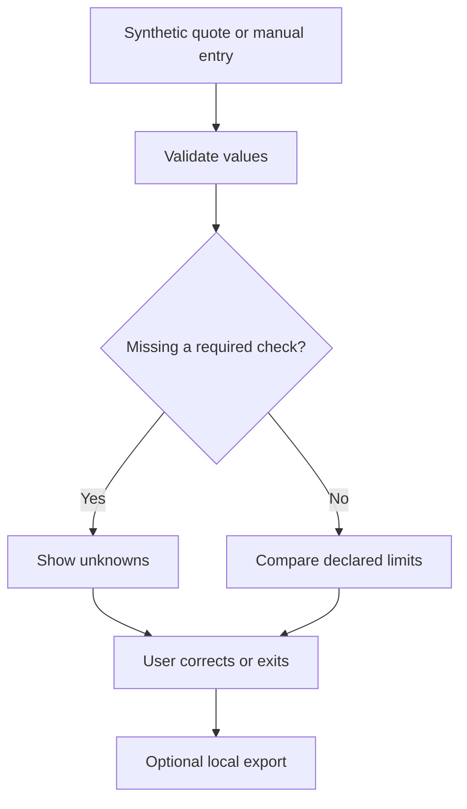

# Compra con calma - Week 10 build packet

Yonathan Zeitoune Mattout | Team 6 | ADVERSARY | 14 October 2026

## Status and evidence boundary
Prepared before application implementation. This is an individual proposed slice. The Week 10 team Blueprint and meeting recording have not been supplied, so no team approval, vote, dissent, participation or alignment is claimed. Reconcile with the actual Blueprint before final submission. The source chapter and complete Manifesto/Charter stack still need to be read by the student; the chapter connection below uses the course's Crystal Ball synopsis, not invented quotations or a claimed reading session.

## Problem, user and success
A shopper considering a small furniture purchase can see an attractive installment but miss delivery, total payable or a physical mismatch. Our exact synthetic user is a Spanish-speaking CDMX renter checking a desk or sofa against a self-declared purchase budget and available width. These are scenario assumptions, not interview findings.

Success: enter a quote, delivery and financing totals, available purchase budget, measured item width and available width; get reproducible reasons for a mismatch or a missing check; correct an input and see the result change; leave without buying; export a local review. There is no affordability certification, debt score, credit approval, happiness metric or automatic purchase.

## Chosen vacuum
Regret prevention. A narrow, explainable pre-purchase check can demonstrate an avoided mismatch without claiming to optimize a person's life. Physical compatibility and arithmetic are separable from subjective desire. No store, sales recommendations or paid ranking.

## Provisional adversary conditions (not a team Blueprint)
1. Incomplete values remain unknown. Unknown delivery is not zero. Missing evidence must not produce an all-clear.
2. The user sets and can revise limits. The app cannot spend money, veto a purchase or infer needs from sensitive traits.
3. Show total payable, cash comparison and source status separately. A quoted monthly amount is not the total cost.
4. No merchant commissions, referral links, selling user data or paid placement in this prototype.
5. Shadow clause: optimization must not become coercion. Show reasons, correction and exit, with no happiness score or automatic action.
6. Use synthetic examples only. No account, backend, analytics, persistent browser storage or personal financial profile. Reset and reload clear review data. A deliberately downloaded report is a separate file controlled by the user.

## Technology honestly
This slice uses deterministic browser code, not a live AI agent or vision model. It cannot extract dimensions or prices from an image, establish a product's quality, read a bank account, verify a retailer quote or observe future regret. A file/image upload that does nothing would misrepresent vision, so it is cut. A future vision proposal must return field-level source crops, allow correction, abstain on unreadable fields and test against manual entry before shipping. The Week 10 mockup is AI-generated; that does not make the application inference AI-powered.

## AI-generated mockup
The requested image was generated before application implementation and is preserved in docs/mockup.png. Design: ivory background, forest green headings, two-column buyer checklist, clearly separated unknowns and conflicts. The concept image contains euro examples; the implementation uses MXN and removes generic wellbeing language. The image is a design reference, not a tested app screenshot.

## Flow

## Benchmarks and translation
YNAB: user-directed spending targets; adapt explicit limits, but our prototype has no account connections or claim to represent a full household plan. https://support.ynab.com/how-to-use-targets-rk5kkI9ks

camelcamelcamel: historical price context and alerts; adapt evidence visibility. Its terms say price/availability may change. Coverage, retailer-specific identifiers and Mexican delivery totals require independent verification, so the prototype does not scrape or claim Mexican price coverage. https://izer.camelcamelcamel.com/features and https://camelcamelcamel.com/tos

PROFECO El Buen Fin: a Mexican comparison starting point already exists. Link to the official tool for a separate check, without suggesting a partnership or complete product coverage. The localization task is combining relevant evidence with a buyer's declared constraints, not pretending Mexico lacks comparison tools. https://elbuenfin.profeco.gob.mx/

Benchmark line: compare a plain manual checklist with this fixed-rule version using identical synthetic quotes. Later evaluate a vision-assisted version only if it reduces correction burden without increasing false all-clear outcomes. No measured 10:1 or regret reduction is claimed.

## Long view
The course synopsis of Isle of Happiness warns that an optimizing system can turn wellbeing into a cage. Computation may become cheap while trust, control and accountable incentives remain binding. This tool therefore returns inspectable comparisons to the shopper. If a richer future agent cannot preserve correction, exit and a visible no-purchase option, its extra automation is not progress under this design.

## Architecture and scope
| Component | Choice | Boundary |
| --- | --- | --- |
| UI | HTML/CSS/JavaScript, Spanish | Accessible forms, mobile layout |
| Rule engine | Pure JS function | Finite nonnegative values, cent arithmetic |
| Data | Runtime memory only | Synthetic examples; no database |
| Hosting | Sites static publication | New Site initially private; public access must be confirmed |
| Export | Browser-generated text file | Explicit download only |
| AI | Image mockup only | No inference endpoint, no API key |

Cuts: image extraction, real bank data, cross-platform debt aggregation, personalization scores, checkout, retailer links with commissions, real people, marketplace feeds, notifications and savings promises. Supabase Auth/RLS are not configured because no personal-data backend exists; this is not a claim that a future personal-data version meets that security floor.

## Test plan
T01: cash 2,800 + delivery 350 = 3,150; budget 3,000 flags 150 over.
T02: unknown delivery remains missing, even if cash is below the budget.
T03: installment count 6 and amount 500 = 3,000 plus delivery 350 = 3,350; compare with cash total 3,150.
T04: zero explicit delivery is valid, blank is unknown.
T05: item 160 cm and available 150 cm flags a 10 cm mismatch; equality passes this single dimensional check only.
T06: negative, nonfinite, excessive amounts and fractional payment counts rejected.
T07: switching cash/installments changes required fields and totals.
T08: changing an input invalidates the prior result and export, preventing stale guidance.
T09: user strings render as text, not HTML; no outbound fetch, storage or tracker.
T10: reset clears fields/result, and export includes limitations and exact inputs.
T11: synthetic persona inspection checks that 'no conflict found' is not mistaken for a buy recommendation; fix the worst observed ambiguity and repeat the same scenario.

## Shipping evidence to collect
At least five meaningful commits and two actual deploys. Record a real failing test, repair and redeploy. Keep a verbatim build log of real messages and tool actions; do not invent user pushback or elapsed time. Browser screenshot walkthrough is unverified if browser QA is unavailable. Public GitHub link and anonymous live access must be confirmed, not assumed from a private source repository. Student records DEMO (3 min + 30 sec) and REFLECT (2 min, camera on). Brain requires the actual fresh-chat 40+ minute argument and raw export; an assistant-authored discussion cannot substitute for that evidence.
