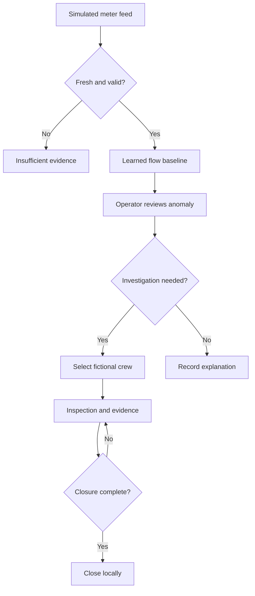
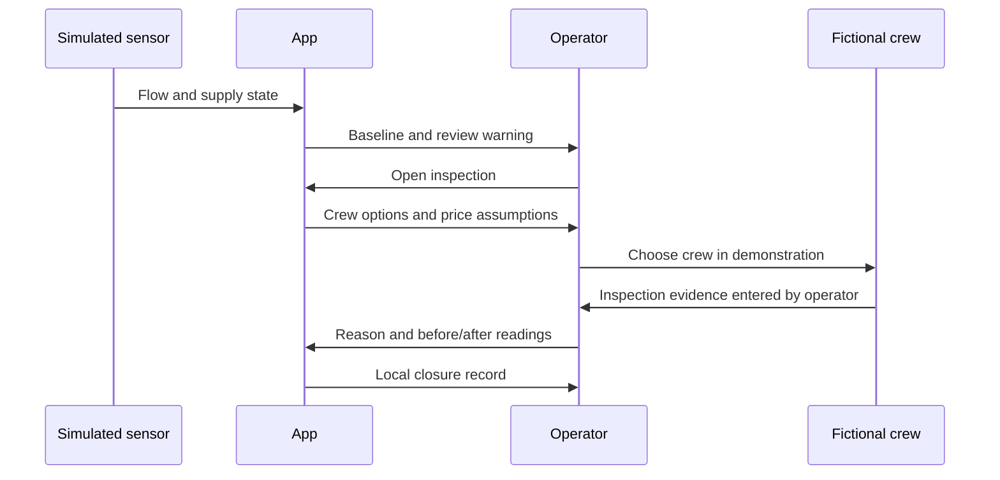

# PACKET - Week 11 - Agua en claro
Yonathan Zeitoune Mattout | Team 6 | OPERATOR
Planning record. Individual proposal; alignment with the Week 11 team Blueprint is pending.

## Problem and exact user
A maintenance operator in a small CDMX building can see a suspicious meter reading without knowing whether it is a leak, tank refill, interrupted supply, or missing telemetry. The slice turns a reading into a bounded inspection with an owner and closure evidence. The operator is a design target, not an interviewed research participant. No interview or willingness-to-pay evidence is claimed.

## Success before the module closes
At a deployed URL, the operator can select a simulated sensor scenario, inspect a learned flow baseline, see an explicit insufficient-data state, open an inspection, choose a fictional crew, and close it only with a reason and before/after evidence. A simulated feed plus a small regression model trained in-browser plus crew-marketplace matching meets the intended Dragon Stack experiment. This is a workflow demonstration, not a calibrated leak detector.

## Image-generated mockup
See the accompanying generated mockup. It is a visual design reference, not a screenshot proving implementation.

## Flow

## Global benchmark and localization
The strongest benchmark for network event management here is TaKaDu CEM; this proposal differs by narrowing to a small-building, Spanish-language inspection handoff with explicit tandeo and unknown-data states. TaKaDu is already marketed by IIASA in Mexico, so absence from Mexico is not the thesis. WINT demonstrates building-level monitoring and configurable shutoff; Gutermann demonstrates installed acoustic sensing and event workflows. Neither their detection accuracy nor their economics transfers to this demo.

## Three-year direction
If a field pilot proves operators complete inspections, this could become a meter-to-maintenance service for small buildings. Hardware installers and authorized maintenance crews would own verified physical work while the software preserves evidence and consent. Expansion would depend on field calibration, procurement, service coverage, authenticated tenancy, and a sustainable payer rather than a dashboard engagement metric.

## Proposed conditions to take into Team Bending
1. A warning never equals a confirmed leak.
2. Missing telemetry is unknown, never healthy.
3. No valve actuation or automatic water cutoffs.
4. Human review must consider tank refill and supply interruptions.
5. Close only with cause plus before/after readings; no liters-saved claim without comparable measurements.
6. Synthetic data and fictional crews remain visible; no real addresses, payments, dispatches or personal data.
These are individual proposed conditions, not a record of team agreement.

## Scope cut
No physical IoT hardware, utility integration, acoustic localization, water-quality determination, real marketplace transaction, external dispatch, personal profiles, multiuser database, or verified savings. No awareness campaign or recycling tips. No claim of having read unavailable chapter text; the thematic shadow interpretation is grounded in the course brief's unequal access to abundance and must be checked against the assigned chapter.

## Architecture and stack
| Layer | Implementation | Honest boundary |
|---|---|---|
| IoT/sensing | User-selected simulated hourly flow feed | No live sensors |
| ML | Least-squares regression trained on synthetic normal flow, predicts hourly baseline | Running model, unvalidated for field use |
| Marketplace | Filter fictional crews by skill, compare assumed fee and arrival window | No contact, booking, payment or SLA |
| UI | Buildless HTML/CSS/JS | Browser-local session only |
| State | In-memory inspection record with downloadable JSON | Reset on reload; no personal data |
| Hosting | Sites preview and deployment | Private access may not satisfy independent professor access |
| Source | Site source repository | GitHub mirror remains required by rubric |

## Test plan
- Normal feed: no review recommendation caused by nominal variation.
- Sustained abnormal flow: request inspection, never assert confirmed leak.
- Missing sensor: suppress inference and clearly say insufficient data.
- Tandeo/refill: separate supply context from suspected physical loss.
- Forms: reject empty cause, negative/nonfinite readings, excessive text and mismatched crew skill.
- Close: require an open inspection, selected crew, cause, before/after values and evidence note.
- Export: JSON includes synthetic label, model limitations and inspection state; no executable text rendering.
- Mechanical: document an actual failing case, fix it, rerun it, deploy again.
- Persona: synthetic walkthrough using actual screenshots; log confusion and fix the worst one, then retest. A synthetic test is not human validation.
- Responsive: inspect desktop and narrow layouts where available.

## Implementation prompt
Build the bounded operator flow above. Acceptance: all scenario states explicit; regression trained on synthetic data and described accurately; marketplace choices fictional and skill-filtered; no physical actions; closure blocked without evidence. Commit plan: packet; model; dashboard; inspection workflow; tests and fix; deployment evidence. First deploy before the defect fix, second after it. Retain the real development record; do not invent user pushback, timestamps, meetings or tests.

## Sources checked 21 October 2026
- https://www.takadu.com/solution/
- https://www.iiasa.com.mx/takadu/
- https://wint.ai/frequently-asked-questions/
- https://en.gutermann-water.com/product/zonescan-ai-correlating-iot-leak-logger/
- https://www.wateraid.org/et/sites/g/files/jkxoof401/files/2024-07/M3-Manage%20Non-Revenue%20Water-%20WaterAid-EWTI.pdf
