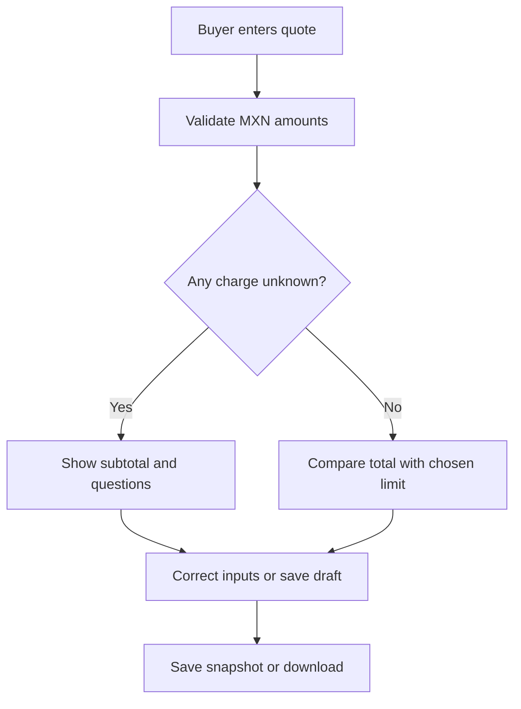
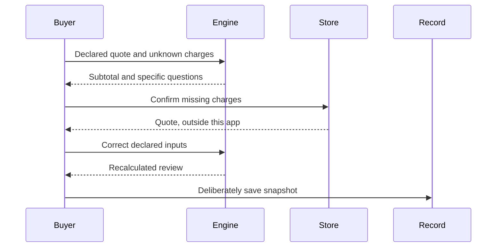

# Week 12 Build Packet - Compra con calma
Written before the Week 12 rebuild | Yonathan Zeitoune Mattout

## Problem / exact user
An adult buyer sees a furniture price but cannot yet establish the full delivered cost. The privately reported buyer case anchors the need; public demos use fictional examples. See CHARTER.md, PERSONAS.md, METHOD.md and VERDICT.md for provenance and bounds.

## Success before close
A user enters price and confirmed charges, leaves unknown charges blank, receives a lower bound or complete total, compares only a complete total with a personal limit, resolves the listed missing charges, and deliberately saves or downloads the exact review. Changing inputs immediately invalidates any prior result. A complete arithmetic review never recommends buying.

## Image-generated mockup
docs/mockup.png is the design target: an ivory and evergreen cost-review form, amber unknown-charge panel and separate save action. A concept image is not a tested app screenshot.

## Feature flow

## Responsibility flow

## Benchmark line
The strongest baseline for this exact bounded task is a manual complete-cost checklist plus a calculator. YNAB provides an established example of user-directed spending targets; our difference is field-level unknown charges and an explicit evidence-to-action checklist for MXN furniture quotes. This is a design comparison, not proof of superiority or a current market ranking. Source carried from Week 10: https://support.ynab.com/how-to-use-targets-rk5kkI9ks . Current product documentation will be checked before external capability claims are made.

## Long view
In three years the product could help buyers maintain a portable, inspectable review of a purchase. It would add new categories only after observing repeated unresolved cost questions. Its independence would depend on a payer model that does not reward a particular purchase.

## Scope cut
One cost-review feature. Cut dimensions, financing plans, debt aggregation, photo extraction, AI chat, recommendations, checkout and notifications. Retailer charges are entered by the buyer; no external quote is verified by the engine.

## Architecture
| Layer | Implementation target | Evidence boundary |
| --- | --- | --- |
| Interface | React + Vite + Tailwind, Spanish | Responsive cost-review workflow |
| Logic | Pure JS integer-cent engine | Known input arithmetic and explicit missing fields |
| Local record | Optional browser storage and JSON download | This browser only, not a cloud save |
| Cloud target | Supabase Auth/Google + owner-only rows | Must be connected and tested before claimed live |
| Publication | Vercel target; existing Sites fallback | Custom domain is still required for grading |
| Repository | Existing Sites source, GitHub mirror target | No secrets or real customer demo data |

## Test plan / acceptance criteria
1. Blank delivery is unknown; explicit 0 is known.
2. 14,600 + 800 + 600 + 0 = 16,000 for a fictional scenario, not a real quote.
3. Missing charge produces a subtotal and no within-limit verdict.
4. Known subtotal above limit flags that fact even before a final total is available.
5. Validate negative, NaN, exponent, excessive and fractional-cent inputs.
6. Equality to limit reports equality without recommending a purchase.
7. Editing invalidates displayed result and disables stale saving.
8. Save/reload/delete keeps exact snapshot and handles unavailable storage visibly.
9. User text renders as text, never HTML.
10. Synthetic persona screenshot walkthrough: identify worst confusion, repair, repeat.

## Commit / deployment plan
Commit charter and packet before rebuild; commit engine; commit React routes; commit persistence and tests; commit observed bug/copy fixes. Deploy once, reproduce an actual defect, fix and deploy again. Do not manufacture a failed test or claim a deployment from a local build.

## Security floor
No secrets in source. Demo seeds are invented and have no names, ages or identity fields. Forms bound lengths and integer-cent numeric values. Supabase tables require auth.uid() owner policies and Google auth before real personal data is accepted. Local mode explicitly states its storage scope. No tracker, retailer referral commission or outbound customer transmission.
