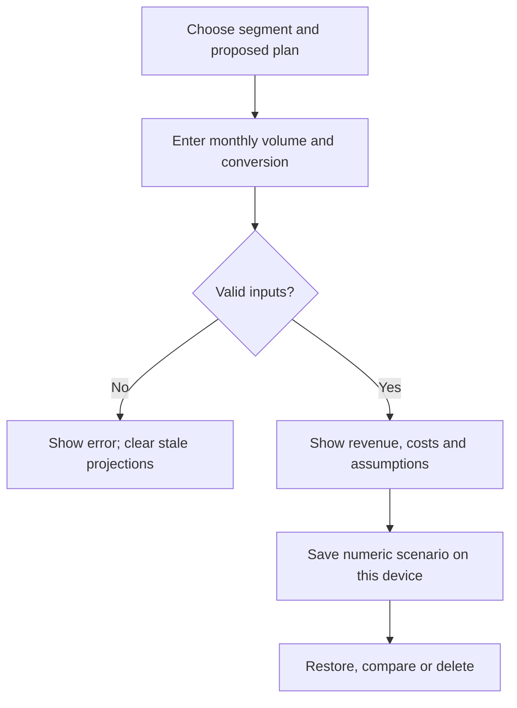
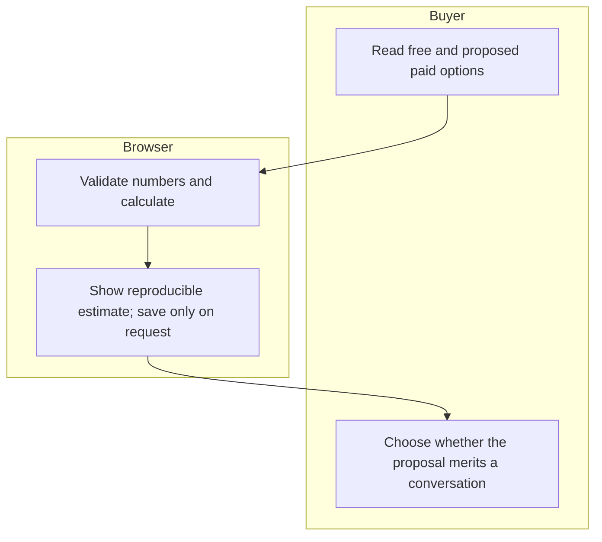

# Week 14 - Compra con Calma: pricing before confidence
Yonathan Zeitoune Mattout | Team 6 | Adversary | 10 November 2026

## Problem and exact user
An adult in Mexico comparing furniture quotes needs to separate confirmed charges from unknown amounts. The initial case in the Charter is second-hand and unmeasured. The commercial problem is whether a repeatable comparison is worth paying for when notes and a calculator are free.

## Success before the module closes
Public /pricing shows three proposed tiers and two payer segments. A working simulator projects monthly and annual revenue from explicit volume, conversion and price assumptions, plus costs. Save, restore and delete numeric scenarios locally. /about contains a one-page 10:1 memo with the same prices and baseline arithmetic. Preserve the working quote checker and its unknown-versus-zero rule. No measured 10:1 advantage is claimed.

## Prices and free/paid boundary
Household buyer: Esencial MXN 0 for one quote and missing-charge checklist; Comparar MXN 49 once per purchase project for a proposed multi-quote comparison workflow. Independent decorator or small purchasing professional: Profesional MXN 149/month for a proposed repeated-project workflow. No seller commissions. These are test prices, not accepted offers; no billing, paid entitlement or subscription is activated. The numeric revenue sandbox and quote checker are available as demonstrations. Advanced paid workflows remain proposals.

## Image-generated visual specification
An image-generated mockup is being prepared for this packet: cream background, forest-green text, three price cards, clear proposed-price label, transparent simulator. It is a design reference, not a screenshot or evidence of implemented behavior.

## Flow

## Benchmark and translation
YNAB demonstrates buyer-funded transparent subscription pricing; its official pricing FAQ says USD billing and direct bank import limited to selected US, Canadian, UK and EU banks. A Mexican adaptation must avoid assuming local banking coverage or charging a global subscription for a rare furniture decision. Splitwise separates a free core from paid convenience; do not hide the missing-cost warning behind payment. IKEA Mexico already explains delivery and assembly charges; a retailer-specific calculator can substitute for our tool within that retailer. Our only possible difference is a Spanish, MXN, cross-retailer uncertainty record. That difference is a hypothesis, not a moat.

## Long view
In three years the product could become an independent purchase-evidence record controlled by buyers. Its north star remains resolving an initially unknown charge with a real quote before deciding. Expansion requires measured utility and voluntary payment, not selling access to buyer intent.

## Scope cut
No bank connection, checkout, merchant verification, quote uploads, account system, personal data, paid entitlement, AI prediction, promised savings or fabricated research. No new domain purchase: the user previously declined one. Team conditions are proposals until the new team's real meeting.

## Architecture and stack
| Layer | Choice | Reason |
| --- | --- | --- |
| UI | Static HTML/CSS and vanilla JS | Free, inspectable, Spanish-first |
| Domain rules | Small pure JS functions | Same arithmetic in UI and tests |
| Saved scenarios | Explicit localStorage, numeric fields only | No identities or private quote uploads |
| Hosting | Existing compra-con-calma-w14 Vercel project | Preserve the established project |
| Source | Existing Cuaderno GitHub repo, w14 directory | Preserve older weekly work |
| External services | None | No credentials, payments or data transmission |

## Same assumptions across the product
All numbers below are assumptions, not observations. Monthly household visitors 1000; conversion 5%; per-project price 49; professional prospects 100; conversion 5%; monthly price 149. Constant-month annualization, no growth or cumulative subscription cohorts. Processing provision 3.5% of price; variable support 10 per household project and 20 per professional month; fixed monthly cost 500. Prices treated as gross customer amounts; tax, acquisition, churn and fixed-cost sensitivity must be assessed before launch. Contribution after provision is not accounting net profit. Gross monthly revenue = 1000*.05*49 + 100*.05*149 = 3195; annualized gross = 38340.

## 10:1 definition
Compare the same task and period: baseline total cost / (product price + remaining user time cost). Household one project: manual 30 minutes at MXN120/hour =60; app 5 minutes=10 plus49=59; ratio 1.02, not10. Professional 20 quotes/month: baseline1200; app time200 +149=349; ratio3.44. Exclude unmeasured risk reduction rather than count a possible fee as guaranteed savings. Benefit/price is a separate measure and must never be swapped into this denominator. No 10:1 claim survives these assumptions.

## Test plan before code
1. Quote: unknown is not zero; known blank is invalid; negative, whitespace and boolean inputs rejected; complete sum correct.
2. Simulator: household project revenue and professional monthly revenue calculated separately; annual=12*month; zero conversion yields zero revenue; negative, blank, infinity and conversion>100 rejected.
3. UI: invalid edit clears old output, blocks save and copy; zero price accepted without division errors; currency and period labels explicit.
4. Persistence: save two scenarios, reload, restore exact inputs, delete; malformed or unavailable storage does not crash. No free-text customer data saved.
5. Pricing buttons explain proposed status and available functionality. /pricing and /about direct navigation works.
6. Mechanical defect -> fix -> second deploy, then browser retest. Record exact evidence only.
7. Screenshot-based synthetic persona review is separate from real payer research. No user session or pricing acceptance is invented.

## External evidence still required
A real potential payer must answer whether they would pay MXN49/project or MXN149/month, why or why not, and what they use now. The team's real Fusion, agreed one-page Blueprint and round-robin video, the student's on-camera demo and reflection, and the real Brain discussion cannot be manufactured from planning documents.

## Sources checked 10 November 2026
https://www.ynab.com/pricing
https://kb.splitwise.com/pro/what-is-splitwise-pro
https://www.ikea.com/mx/es/customer-service/services/delivery/

Official Week 14 instructions were read in authenticated Brightspace: overview topic4001622, brief4001623, Brain4001624, Team4001625, Business4001626, Future4001627. Module closes 15 November2026 at23:59 as displayed by the course. Brain requires two pages plus a full raw40+minute discussion export. Business requires minimum five commits, two deploys, generated mockup, Mermaid flow, mechanical and synthetic persona passes, demo, packet and development transcript. A custom real domain is the required URL of record; the current Vercel subdomain does not meet that requirement.
