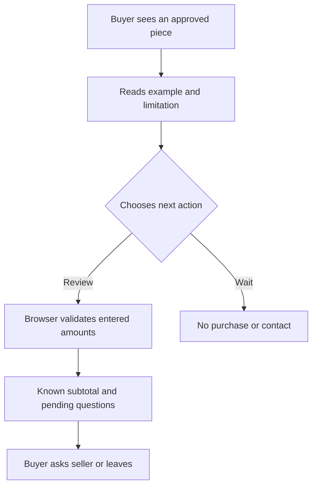

# Week 15 - Distribution: show the missing question
Yonathan Zeitoune Mattout | Team 6 | Adversary | 20 November 2026

## Specification before implementation
Continue the existing Compra con Calma app, repository and Vercel project. Preserve the quote checker, pricing proposals and continuing release history. This document precedes the Week 15 implementation. The uploaded Week 15 instructions replace the earlier domain requirement: an evaluator-accessible safe demo on a suitable host is accepted; no paid domain is required.

## Problem, exact audience and need moment
First audience: Spanish-speaking adults in CDMX/Estado de Mexico who have a furniture quote and are considering a deposit while delivery, assembly or other mandatory charges remain unclear. Geography is a recruitment choice, not a measured market boundary. User and potential payer are the same household buyer. Existing free quote review remains free. MXN 49/project and MXN 149/professional month remain unvalidated proposals; no billing is active. Professionals are a later segment, not the target of this campaign.

Current workaround hypothesis: the buyer keeps a store message or quote and uses a calculator, notes and follow-up questions. The Charter contains one second-hand buyer case, not an interview sample. PROFECO's furniture guidance explicitly advises asking about freight and installation and obtaining written terms. This establishes relevance of a question, not demand for our app. IKEA Mexico publishes delivery and assembly conditions; use the actual seller's information rather than an invented national tariff.

## Success definition and scope cut
The release offers a shareable /guia page with three finished assets across image, printable PDF and web/text formats; each directs the buyer to the working free quote review. Six concepts belong to three repeatable series. A fictional input shows MXN 14,600 base + MXN 700 delivery = MXN 15,300 known subtotal, with assembly and other charges still unknown. This is not a final total or an observed transaction.

Build success is a functioning content-to-review path with correct arithmetic and clear unknown states. Audience success is a separate test: invite up to five consenting target buyers, show two pieces, and observe whether at least three correctly identify an unknown charge and the next action without explanation. This is a small directional test, not market validation. No invitations, responses, conversions or savings are asserted before observation. No new social account, ten-post quota, campaign scheduler, automated messaging, personal-data capture or paid framework.

## Strategy and promise boundary
Position: a small, independent pre-deposit quote check. Promise supported by code: separate entered amounts from pending costs and produce questions to take to the seller. Rejected promise: verified total, guaranteed savings, safest store, best purchase, 10:1 value or AI-discovered fees. Content worth sharing must teach the same unknown-versus-zero distinction that the live product enforces. Avoid adversarial claims about named stores and avoid countdowns, shame, scarcity and fear.

## Brand system
Voice rules: (1) calm, concrete Spanish; one decision per piece; (2) show the source and boundary next to numbers; (3) use an actionable question instead of a pressure-to-buy claim. Weak line: 'Ahorra miles y compra sin riesgos con IA.' Revision: 'Antes del anticipo, separa lo confirmado de lo pendiente.' The revision promises an inspectable task and does not invent savings.

Palette: cream #F8F7F1 background; forest #1D3F35 headings; terracotta #9E573C pending/next-step accent; white #FFFEF9 panels. Labels accompany colors. Type: Georgia headline 40-64px; system sans body 16-18px; evidence labels at least 13px. Repeated layout: series + number, one question, illustrative evidence, explicit limitation, one CTA. Spanish labels, MXN and 'anticipo', 'flete' and 'armado' match the purchase context without assuming all Mexican consumers behave alike. Mobile layout stacks panels; no horizontal card text crop.

## Six concepts / three series
| ID | Series | Concept | Format / status | Next action |
| --- | --- | --- | --- | --- |
| A1 | Lo pendiente cuenta | Que no aparezca no significa que cueste cero | Finished 1080x1350 poster + web card | Free quote review |
| A2 | Lo pendiente cuenta | Incluido, por confirmar o no aplica: que lo diga la tienda | Purposeful headline sketch | Ask seller for written scope |
| B1 | La cuenta abierta | 14,600 + 700 = 15,300 conocidos; dos cargos pendientes | Finished 3-page printable carousel + web example | Reproduce the example |
| B2 | La cuenta abierta | Dos cotizaciones: una suma menor no prueba menor costo final | Sketch with two incomplete examples | Resolve the missing amounts |
| C1 | Pregunta antes del anticipo | Tres preguntas para llevar a la tienda | Finished copyable web checklist + printable page | Copy questions / free review |
| C2 | Pregunta antes del anticipo | Una respuesta por escrito vale mas que nuestro subtotal | Purposeful headline sketch | Confirm scope and validity |

## Creative process - accountable roles
| Stage | Input | Output | Quality gate |
| --- | --- | --- | --- |
| Research | Charter, app behavior, official sources | Claim ledger and audience hypothesis | Source supports exact claim; no demand inferred |
| Writing | Approved claim and one need moment | Six concepts, three selected drafts | One job, one next action, plain Spanish |
| Visual production | Copy + brand tokens | Poster, carousel, web checklist | Legible mobile text; visible synthetic-data label |
| Evidence review | Drafts + deterministic engine | Checked numbers and limitations | 14,600+700=15,300; unknown never zero |
| Style review | Rendered assets and source copy | Consistent hierarchy and labels | Calm tone; no urgency or unverified AI claims |
| Revision | Real defect or comprehension risk | Changed piece + repeated check | Record what changed; human approval before outreach |

The assistant performs these stages in this session; this is not a claim of six independent agents or a paid automation. Yonathan retains editorial approval and controls any audience outreach. No automatic posting or sending is part of the implementation.

## Real input -> method -> useful output
Real source input: the current quote engine distinguishes declared known amounts from unknown delivery/assembly/other amounts. The initial Charter's case supplies context without identifiable details. Numerical example is synthetic: price 14,600, delivery 700 confirmed, assembly/other unknown. Research selects the problem; writing removes 'save thousands'; visual production keeps 'known subtotal' beside 15,300; evidence checking runs the engine; style review keeps a calm question; revision makes clear that a confirmed zero requires entering 0. Output is the B1 carousel and its link to the same state in the working reviewer. No quote upload, merchant verification or actual buyer outcome is claimed.

## Distribution design and honest result register
One channel: voluntary direct sharing of the /guia page in an existing conversation with a person who agrees to help, not unsolicited bulk messages. Test A1 and B1; C1 supports the follow-up task. Suggested invitation (not sent): 'Estoy probando una guia para revisar cotizaciones de muebles antes del anticipo. Si estas por comprar uno y te interesa ayudar, puedes ver dos ejemplos aqui. Es voluntario; no necesito tus datos ni tu cotizacion.'

Expected before test: among up to five eligible opt-in viewers, at least three identify that 15,300 is incomplete and can reach the free checker. Record denominators and observation window after sending. Reach: not measured. Unique clicks: not instrumented. Captures: not collected. Eligible invitations: not sent by this session. Responses: not observed. These are pending, not zero response from an executed experiment. No identities, screenshots of private chats or quote details belong in the report. If nobody responds after a documented test window, report invitations sent, window and zero replies; do not fabricate a quote or testimonial.

Keep/change rules: keep an asset if people can name its audience, boundary and next action; revise 'subtotal' if it is interpreted as final; remove unsupported language before testing; do not call a like a completed review. A click alone does not establish understanding or purchase benefit.

## Architecture and security
Existing static HTML/CSS and vanilla JS, QuoteEngine, pricing simulator, numeric-only deliberate localStorage scenarios; existing Vercel project and Cuaderno directory. New /guia route and static assets. Bounded source IDs select only one fixed fictional sample; no arbitrary parameters or personal fields. Quote inputs remain transient. No database, Auth, RLS, bank access, uploads, tracking pixels, external inference calls or API keys. Auth/RLS are not applicable to this synthetic static release; they become requirements if personal-data persistence is introduced. Hosting access logs may exist; no anonymous unique-user analytics is claimed.

## Visual reference
Reuse the image-generated Week 14 mockup in PACKET_YonathanZeitoune_Week14.pdf, page 4, as the inherited cream/forest design reference. It is not evidence of the new /guia implementation. Its imaginary address and advanced features are not product promises. Current rendered screens and deterministic campaign assets supersede those illustrative details. No new mockup generation is claimed.

## Benchmarks, local adaptation and three-year direction
YNAB: clear user-funded method and visible trial; adapt a concrete task demonstration, not its USD subscription economics or savings claims. Its pricing FAQ limits direct bank import regions; our version needs no bank access. Splitwise: free core and paid convenience; preserve safety questions for free rather than adopting interruptions that obscure them. IKEA Mexico: close-to-source shipping/assembly terms and checkout-specific final cost; our role is a cross-retailer question record, not a competing tariff authority. Sources below do not prove willingness to pay.

Three years: become a buyer-controlled, independent evidence record only if repeated real use resolves missing quote information. The north star remains the share of initially incomplete reviews in which a buyer supplies a real confirmation before deciding. Do not replace it with reach or purchases generated. Seller-funded targeting and optimizing a buyer's 'happiness' remain outside the Charter.

## Test plan before implementation
1. Run inherited pricing and quote engine suite; no regressions.
2. Load /guia, each downloadable asset and the A1/B1 next actions. Keyboard access and mobile wrapping matter.
3. Follow B1 to reviewer: base 14,600 + delivery 700 -> 15,300 known; assembly/other remain unknown.
4. Confirmed zero is valid; blank confirmed field clears result and disables Copy; reset restores synthetic default.
5. Reject arbitrary/overlong campaign IDs; no code execution or user strings in HTML.
6. Confirm no network analytics, no identities or private data stored by new feature.
7. Fix and retest an actually reproduced failure. If no failure occurs, report pass rather than manufacture one. Preserve the Week 14 five-plus commits and two-plus deploys as continuing history.
8. Screenshot-based synthetic persona review is separate from live audience test; a fresh-chat procedure and real user evidence remain distinct gates.

## Evidence and sources
Current Week 15 source: seven HTML files supplied by the user in this conversation. No Brightspace deadline was included in these files. Do not infer a submission deadline.
Charter: w12-compra-con-calma/docs/CHARTER.md. Manifesto: manifiesto.md. Prior pricing/role evidence: Week 14 brief and packet; Adversary rotation applies weeks 14-15. Sources checked 20 November 2026:
- https://www.ynab.com/pricing
- https://kb.splitwise.com/pro/what-is-splitwise-pro
- https://www.ikea.com/mx/es/customer-service/services/delivery/
- https://www.gob.mx/profeco/documentos/muebles-de-linea-y-sobre-medida-87444 (official indexed text available; direct fetch returned 403)

The real 40+ minute Brain exchange, complete original conversation exports, Team Fusion and Blueprint, live audience test, student demo and on-camera reflection cannot be inferred from this packet. Their absence must remain visible in final delivery status.
