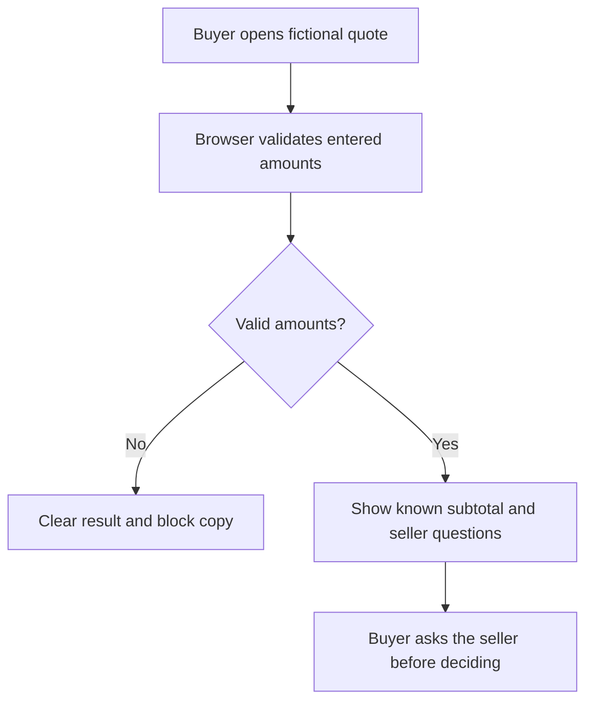

# Week 16 — Hardening
Before implementation, 25 November 2026. Continue the existing Week 15 release.

- Problem and exact user: a Spanish-speaking household buyer with a furniture quote in CDMX or Estado de México who needs to ask about missing charges before paying a deposit. Geography is a recruitment hypothesis.
- Success: a new mobile session correctly distinguishes known amounts, pending charges and explicit zero. Invalid numeric input never produces a credible subtotal or copyable result. Also test an accessibility constraint and the Week 15 evidence-review process.
- Scope: repair the highest-impact reproduced mistake, show evidence, and add the course defense to /about. No new product features or paid domain.
- Stack: static HTML/CSS and deterministic JavaScript. Quote inputs transient. Voluntary numeric-only local storage belongs to the pricing simulator. No accounts, checkout, database or AI calls.
- Inherited image-generated design reference: Week 14 packet, p. 4. Use current rendered screens as behavior evidence.
- Benchmark: IKEA México exposes seller-specific delivery conditions. Keep source and amount provenance clear across sellers. Splitwise makes currency explicit. Keep this task in MXN and leave unconfirmed items visibly unresolved.
- Three-year direction: a buyer-controlled purchase evidence record, conditional on demonstrated utility and an independent funding model.
- Shadow clause: an incomplete or invalid quote must never authorize a deposit. Label subtotals, preserve missing values, require explicit zero, block invalid results and leave the decision with the buyer.

Compare mobile quote, safe invalid input/claim review, and keyboard access. Retest a reproduced failure with the same inputs. Carry forward the deployment and commit history in TEST_LOG_W15.md and SESSION_CLOSE.md.
